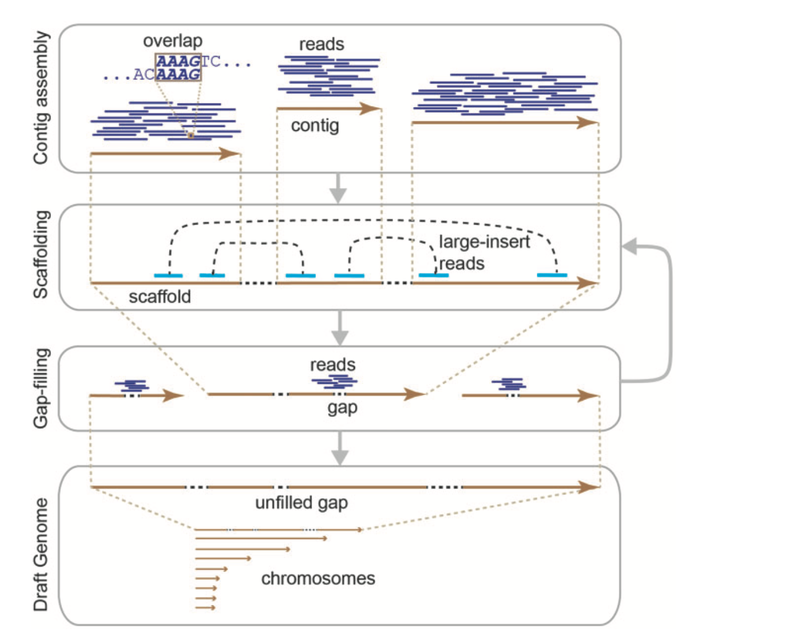

# Genome assembly

## Some theory

### What is a genome assembly?

[Ensembl definition](https://www.ensembl.org/info/genome/genebuild/assembly.html)
>A genome assembly is a computational representation of a genome sequence. Because we cannot sequence the full length of a chromosome, each chromosome assembly is made up of short stretches of sequenced DNA pasted together.

Basically, assemblers need to solve giant jigsaw puzzles with millions of pieces, some missing altogether and some containing errors. **They perform some of the most complex computations in all biology**

-----

## Main steps in basic genome assembly

1. Contig assembly + error correction (depending on the type of reads)
2. Scaffolding
3. Gap filling



### Some definitions

**Contig**: “a contiguous sequence generated from determining the non-redundant path along an ordered set of component sequences. A contig should contain no gaps, but often the terms contig and scaffold are used interchangeably”

**Scaffold**: “an ordered and oriented set of contigs. A scaffold will contain gaps, but there is typically some evidence to support the contig order, orientation and gap size estimates.”

**Assembly**: “a set of chromosomes, unlocalized and unplaced (random) sequences and alternate loci used to represent an organism’s genome. Most current assemblies are a haploid representation of an organism’s genome, although some loci may be represented more than once (see Alternate locus, above). This representation may be obtained from a single individual (e.g. chimp or mouse) or multiple individuals (e.g. human reference assembly). Except in organisms bred to homozygosity, the haploid assembly typically represents a mixture of haplotypes rather than a single haplotype. As sequencing technology evolves, it is anticipated that diploid sequences representing an individual’s genome will become available.”

**Diploid assembly**: “A genome assembly for which a Chromosome Assembly is available for both sets of an individual’s chromosomes, as defined by the NCBI Assembly model. A diploid genome assembly is expected to represent the genome of an individual. Therefore, it is not anticipated that alternate loci will be defined for this assembly, although it is possible that unlocalized or unplaced sequences could be part of the assembly.”

**Primary Assembly**: “Relevant for haploid assemblies only. The primary assembly represents the collection of assembled chromosomes, unlocalized and unplaced sequences that, when combined, should represent a non-redundant haploid genome. This excludes any of the alternate locus groups.”

**Unlocalized sequence/scaffold**: “A sequence found in an assembly that is associated with a specific chromosome but cannot be ordered or oriented on that chromosome.”

**Unplaced Sequence/scaffold**: “A sequence found in an assembly that is not associated with any chromosome.”

Source: [Genome Reference Consortium](https://www.ncbi.nlm.nih.gov/grc/help/definitions/#:~:text=The%20primary%20assemblies%20represents%20the,a%20non%2Dredundant%20haploid%20genome.)

### 1\. Contig-level assembly

Main assembly algorithms :

1. **Overlap Layout Consensus (OLC)**

    

2. ***De Bruijn Graph* approach**

    

### 2\. Scaffolding

1. **De novo scaffolding**

    - Genetic mapping
    - Bacterial Artificial Chromosome–End Sequencing
    - Linked-Read Sequencing
    - Optical Maps
    - Proximity Ligation: Regions of the genome that are close together in sequence generally have more frequent physical contact than parts of the genome that are far apart in sequence. Nevertheless, regions on the same chromosome, even those megabases apart, contact each other more often than they contact regions on other chromosomes.

2. **Reference - based/Sinteny - based scaffolding**

    

### 3\. Gap-filling

-----

## What can influence our genome assembly?

1. Nature and characteristic of the genome being sequenced (Ploidy, repetitive content, heterozigosity ecc…).
2. Quality of the extracted DNA.
3. Type of sequencing technology.
4. Read coverage.
5. Assembly software.

### The heterozygosity problem


Typically, the more money you have, the more high-quality data you get, and the more likely you are to assemble a good-quality genome. However, money isn't everything, and today's big genome projects rely on large consortia with bioinformaticians who are highly experienced in genome assembly and can manually curate assemblies (*e.g.* [Darwin Tree of Life](https://www.darwintreeoflife.org/data/), [Vertebrate Genomes Project](https://vertebrategenomesproject.org/)).

-----

## How can we evaluate our assembly?

Some, but not all, metrics :

1. **N50**: the length of the shortest contig for which longer and equal-length contigs cover at least 50 % of the assembly. It evaluates the **contiguity** of an assembly.
2. **[BUSCO](https://busco.ezlab.org/):** a set of Benchmarked Universal Single-Copy Orthologs (BUSCO) that should be present at a certain taxonomic level. Busco genes are marked as C:complete \[D:duplicated\], F:fragmented, M:missing. This provides an evaluation of the completeness and redundancy of our assembly. Precomputed single-copy OG can be found [on the official release page](https://busco-data.ezlab.org/v5/data/lineages/)
3. **spectra-cn ([KAT](https://kat.readthedocs.io/en/latest/walkthrough.html)):** The assembly spectra copy number plot checks assembly coherence against the content within reads that were used to produce the assembly. Basically we represent how many elements of each frequency on the read’s spectrum ended up not included in the assembly, included once, included twice etc.”


-----

## Practice

### Contig level assembly

We will use **[Wtdbg2](https://github.com/ruanjue/wtdbg2)** a very fast assemblers that use long reads, but keep in mind that many others exist and each one of them could perform better with different kind of data(*e.g* [CANU](https://github.com/marbl/canu); [Falcon](https://github.com/falconry/falcon);[HiFiasm](https://github.com/chhylp123/hifiasm))

#### Assemble reads, construction of contig layout and edge sequences (14 mins - 30 threads, 20 mins with 20 threads)

```bash
wtdbg2 -x rs -g <EXPECTED_GENOMESIZE> -t <NUMBERS_OF_CORES> -i <FASTQ> -fo <OUT_PREFIX> #Default parameters
```

- '-x' #define the sequecing method. rs means PacBio RSII and sets some default parameters (listed in the program's help page).
- '-g' #the expected genome size inferred using GenomeScope
- '-t' #number of cores to parallelise the process
- '-i' #require the long-read file, which can be compressed
- '-fo' #the prefix of our output

#### Produce final consensus in FASTA format (~70 mins with 30 threads)

wtpoa-cns is needed to polish or generate a consensus sequence from long-read data. It runs after the initial genome assembly to improve the accuracy of the assembled contigs.

```bash
wtpoa-cns -t <NUMBER_OF_CORES> -i <LAYOUT_FILE-.ctg.lay.gz> -fo <OUT_PREFIX>
```

See the GitHub page for useful tips (and check the “issue” page).

Before proceeding, check the quality of our first assembly. In this case, we will use only BUSCO and check completeness against a known set of genes.

```bash
export NUMEXPR_MAX_THREADS=<CPU_number>
busco -m <MODE> -l <LINEAGE> -c <CPU_NUMBER> -o <OUTPUT_NAME> -i <INPUT>
```

The first `export` sets `NUMEXPR_MAX_THREADS` to the number of cores we will use during the actual busco command. The options are:

- '-m' #define if we are using genomes or proteomes
- '-l' #redirect to the link of the library of reference
- '-c' #the number of cores to parallelise the process
- '-o' #name of the output **folder**
- '-i' #the input. In our case, the raw assembly

The reference databases are:

- `$BUSCO/diptera_odb12`
- `$BUSCO/culicidae_odb12`

### Genome polishing with short and long reads

Softwares : [Minimap2](https://github.com/lh3/minimap2); [Hypo](https://github.com/kensung-lab/hypo); [Samtools](http://www.htslib.org/)

#### Pre-requisite: Mapping short and long reads (sr ~50 mins with 30 threads + pac ~49 mins with 30 threads)

```bash
minimap2 -ax <PRESET_Options> --MD -t <cores_number> <target.fa> <fastq1> <fastq2> > <SAM_FILE>
samtools view -b <SAM FILE> > <BAM FILE>
rm <SAM FILE>
samtools sort -@<NUM_THREADS> -o <OUT_FILE> <INFILE>
samtools index <INFILE>
```

With:

- '-a' #output in .sam format
- '-x' #preset option applied always before others. For short reads, 'sr'; for long PacBio reads vs reference mapping, 'map-pb'
- '--MD' #output the MD tag (optional alignment tag that encodes mismatched bases in a read when aligned to a reference sequence)

- samtools view #allow conversion between SAM, BAM, and CRAM
- '-S' #needed to detect SAM input format; now input format is automatically detected
- '-b' #BAM output

- samtools sort #sort alignment file

- samtools index #index alignment

> INDIVIDUAL WORK: Calculate mean coverage of short and long reads with [Mosdepth](https://github.com/brentp/mosdepth). [Solutions](./mosdepth_solution.md). The command will start with

```bash
mosdepth -n --fast-mode --by 500 <...>
```

#### Hypo (~ 43 mins with 30 threads)

```bash
echo -e "$R1\n$R2" > <READS_PATH>
hypo -d <DRAFT_Contigs> -r @<READS_PATH> -s <APPROXIMATE_GENOMESIZE> -c <SHORT_READSCOVERAGE> -b <SORTED_BAM_SR> -B <SORTED_BAM_PB> -t <NUMBER_THREADS>
```

### Genome evaluation

#### N50

```bash
assembly-stats <ASSEMBLY> > <stats_log>
```

> In the latest version of BUSCO, similar statistics are already computed usign bbtols. Assembly stats is a more descriptive alternative

#### Busco (~ 8 mins with 30 cores, 10 with 20)

> !! bbtools inside BUSCO does not like one-line FASTA!!

```bash
export NUMEXPR_MAX_THREADS=<CPU_NUMBER>
fold -w <n_characters> <input.fasta> > <output.fasta>
busco -m <MODE> -l <LINEAGE> -c <CPU_NUMBER> -o <OUTPUT_NAME> -i <INPUT>
```

The reference databases are:

- `$BUSCO/diptera_odb12`
- `$BUSCO/culicidae_odb12`

#### KAT (~ 17 mins with 10 threads, 10 mins with 20)

```bash
kat comp -t <NUM_THREADS> -o <OUTPUT_PREFIX> '<FASTQ>...' <ASSEMBLY>
```

> Even if the stats show that hash1 is only the SR1, do not worry. Both SR files have been counted.

Compare your results with :  

- *[Ruditapes philippinarum](https://raw.githubusercontent.com/jacopoM28/CompOmics_Tutorship/main/2023/4_GenomeAssembly/Figures/R.philippinarum_KmerSpectra.png)*
- *[Reticulitermes lucifugus](https://raw.githubusercontent.com/jacopoM28/CompOmics_Tutorship/main/2023/4_GenomeAssembly/Figures/R_lucifugus-main.mx.spectra-cn.png)*

> EXTRA : To remove redundant contigs (*i.e* haplotigs) *[Purge\_dups](https://github.com/dfguan/purge_dups)* is one of the most used softwares. It uses both long-read coverage and self-alignment information to identify and remove poorly collapsed regions of the assembly.
