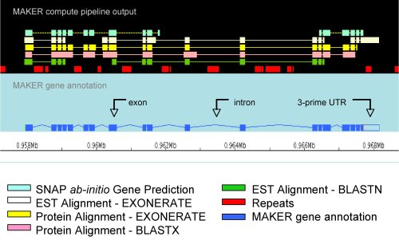

# Genome annotation

Once you have a de novo assembled genome, you usually want to know what genomic features it contains. To do this, we need an annotation pipeline. But what can we annotate on our genome?

1. Repetitive elements (Transposons, low-complexity regions, Microsatellites)
2. Protein-coding genes
3. Pseudo - genes
4. Annotation of tRNA, ncRNA, etc.
5. UTR regions

Eukaryotic genomes are very complex (the result of evolution by molecular tinkering), and gene structures can vary greatly between lineages and even between closely related species (exon length, intron length, gene length, splicing-site sequence patterns, etc.). In model species, highly curated models exist to describe each feature (in the form of HMM profiles). These models can be directly used for *ab initio* gene prediction. However, for non-model species, these patterns are often unknown. To partially address this issue, we can use **external evidence** to directly annotate some features on the genome (*evidence-based* gene prediction) and/or as a source for training *ab initio* gene predictors.

-----

## Genome annotation (easy) workflow

1. Annotation of repetitive elements in the genome. Repetitive regions and transposons must be excluded from gene annotation because they have completely different structures.
2. Alignment of high-quality external evidence (Transcriptomes and proteins).
3. Extraction of an initial set of highly confident gene models.
4. Training of *ab-initio* gene predictors softwares.
5. Re - annotation of the genome through trained models. **Steps 3, 4 and 5 are usually repeated multiple times to improve gene prediction at each iteration**
6. Collection of all gene models and creation of a consensus set based on support given by external evidence (usually gene models low or not supported by external evidence are discarded).
7. Evaluation of our final gene set.

Luckily, multiple genome annotation pipelines exist to facilitate this process. One of the most used is **[MAKER](http://weatherby.genetics.utah.edu/MAKER/wiki/index.php/MAKER_Tutorial_for_WGS_Assembly_and_Annotation_Winter_School_2018)**. Another [great step-wise tutorial](./maker_pipeline.pdf) is loaded in this folder.



-----

## 1\. Transposons annotation

For a quick and dirty transposon annotation, we usually use **[RepeatModeler](https://www.repeatmasker.org/RepeatModeler/)** and **[RepeatMasker](http://www.repeatmasker.org/)**. Basically, RepeatModeler will collect a set of consensus sequences representative of the repeats present in our genome. This library can then be used to annotate the genome. However, keep in mind that this approach is usually only suitable for a raw transposon annotation and is not enough if the goal of our study is an in-depth analysis of TEs.

Due to computational limits, I have already run RepeatModeler for you; the path to the consensus library is:

> /home/PERSONALE/mirko.martini3/Lab_CompGeno/00_practice/00_data/02_Annotation/Anoste_RepeatModeler_library.fa

RepeatMasker will be run inside MAKER, and we will summarize results at the end.

## 2.1 MAKER rnd 1 (~24.5 hours with 40 CPUs)

First, collect your external evidence, for example from NCBI or UniProt. Unfortunately, we don’t have a transcriptome, but in real scenarios it is almost mandatory. Then create and compile the MAKER configuration file needed for the run.

```bash
maker -CTL
```

Three files are generated:

- maker_bopts: parameters for the software used by MAKER; we maintain default parameters. Here, a great source to understand each [input parameter](https://weatherby.genetics.utah.edu/MAKER/wiki/index.php/The_MAKER_control_files_explained) in MAKER.
- maker_exe: paths to all softwares
- maker_opts: MAKER run parameters; here we need to modify

Now we need to set the input file paths in the `opts.ctl` file.

```ctl
    #-----Genome (these are always required)
    genome= <GENOME> #genome sequence (fasta file or fasta embedded in GFF3 file)
    organism_type=eukaryotic #eukaryotic or prokaryotic. Default is eukaryotic
    
    #-----Re-annotation Using MAKER Derived GFF3
    maker_gff= #MAKER derived GFF3 file
    est_pass=0 #use ESTs in maker_gff: 1 = yes, 0 = no
    altest_pass=0 #use alternate organism ESTs in maker_gff: 1 = yes, 0 = no
    protein_pass=0 #use protein alignments in maker_gff: 1 = yes, 0 = no
    rm_pass=0 #use repeats in maker_gff: 1 = yes, 0 = no
    model_pass=0 #use gene models in maker_gff: 1 = yes, 0 = no
    pred_pass=0 #use ab-initio predictions in maker_gff: 1 = yes, 0 = no
    other_pass=0 #passthrough anyything else in maker_gff: 1 = yes, 0 = no
    
    #-----EST Evidence (for best results provide a file for at least one)
    est= #set of ESTs or assembled mRNA-seq in FASTA format
    altest= #EST/cDNA sequence file in FASTA format from an alternate organism
    est_gff= #aligned ESTs or mRNA-seq from an external GFF3 file
    altest_gff= #aligned ESTs from a closely related species in GFF3 format
    
    #-----Protein Homology Evidence (for best results provide a file for at least one)
    protein= <PROTEOME> #protein sequence file in fasta format (i.e. from multiple organisms)
    protein_gff=  #aligned protein homology evidence from an external GFF3 file
    
    #-----Repeat Masking (leave values blank to skip repeat masking)
    model_org=<EMPTY> #select a model organism for RepBase masking in RepeatMasker
    rmlib= <RepeatModeler_library> #provide an organism-specific repeat library in FASTA format for RepeatMasker
    repeat_protein= #provide a FASTA file of transposable element proteins for RepeatRunner
    rm_gff= #pre-identified repeat elements from an external GFF3 file
    prok_rm=0 #forces MAKER to repeatmask prokaryotes (no reason to change this), 1 = yes, 0 = no
    softmask=1 #use soft-masking rather than hard-masking in BLAST (i.e. seg and dust filtering)
    
    #-----Gene Prediction
    snaphmm= #SNAP HMM file
    gmhmm= #GeneMark HMM file
    augustus_species= #Augustus gene prediction species model
    fgenesh_par_file= #FGENESH parameter file
    pred_gff= #ab-initio predictions from an external GFF3 file
    model_gff= #annotated gene models from an external GFF3 file (annotation pass-through)
    est2genome=0 #infer gene predictions directly from ESTs, 1 = yes, 0 = no
    protein2genome=<0 OR 1> #infer predictions from protein homology, 1 = yes, 0 = no
    trna=0 #find tRNAs with tRNAscan, 1 = yes, 0 = no
    snoscan_rrna= #rRNA file to have Snoscan find snoRNAs
    unmask=0 #also run ab-initio prediction programs on unmasked sequence, 1 = yes, 0 = no
    
    #-----Other Annotation Feature Types (features MAKER doesn't recognize)
    other_gff= #extra features to pass-through to final MAKER generated GFF3 file
    
    #-----External Application Behavior Options
    alt_peptide=C #amino acid used to replace non-standard amino acids in BLAST databases
    cpus=<CPUS> #max number of cpus to use in BLAST and RepeatMasker (not for MPI, leave 1 when using MPI)
    
    #-----MAKER Behavior Options
    max_dna_len=100000 #length for dividing up contigs into chunks (increases/decreases memory usage)
    min_contig=1 #skip genome contigs below this length (under 10kb are often useless)
    
    pred_flank=200 #flank for extending evidence clusters sent to gene predictors
    pred_stats=<0 or 1> #report AED and QI statistics for all predictions as well as models
    AED_threshold=1 #Maximum Annotation Edit Distance allowed (bound by 0 and 1)
    min_protein=50 #require at least this many amino acids in predicted proteins
    alt_splice=0 #Take extra steps to try and find alternative splicing, 1 = yes, 0 = no
    always_complete=0 #extra steps to force start and stop codons, 1 = yes, 0 = no
    map_forward=0 #map names and attributes forward from old GFF3 genes, 1 = yes, 0 = no
    keep_preds=0 #Concordance threshold to add unsupported gene prediction (bound by 0 and 1)
    
    split_hit=10000 #length for the splitting of hits (expected max intron size for evidence alignments)
    single_exon=0 #consider single exon EST evidence when generating annotations, 1 = yes, 0 = no
    single_length=250 #min length required for single exon ESTs if 'single_exon is enabled'
    correct_est_fusion=0 #limits use of ESTs in annotation to avoid fusion genes
    
    tries=2 #number of times to try a contig if there is a failure for some reason
    clean_try=0 #remove all data from previous run before retrying, 1 = yes, 0 = no
    clean_up=0 #removes theVoid directory with individual analysis files, 1 = yes, 0 = no
    TMP= #specify a directory other than the system default temporary directory for temporary files
```

Changes to do:

- add genome.
- add proteome (external evidence. Multiple ones can be listed using commas).
- remove model_org.
- provide RepeatModeler library.
- protein2genome= from 0 to 1 #This change enables Maker to use protein homology to infer prediction (needed since we are feeding the program with a known proteome)
- decide number of CPUs to use
- phred_stats from 0 to 1 #This enables the program to calculate Phred score for each annotation.
- add minimum length of protein allowed to be added to the annotation (min_protein=50)
- alternative_splice from 0 to 1
- split_hit empty

External evidence (proteomes):
`/home/PERSONALE/mirko.martini3/Lab_CompGeno/00_practice/00_data/02_Annotation`

**To know**: AED measures annotation quality, indicating how well the predicted gene matches external evidence. It ranges from 0 (perfect match) to 1 (no match).

Then just type:

```bash
maker -base <OUTPUT PREFIX>
```

To create a [gff3](http://www.ensembl.org/info/website/upload/gff3.html) and a transcript/protein file, we can use:

```bash
fasta_merge -d <DATASTORE INDEX FILE>
gff3_merge -d <DATASTORE INDEX FILE>
```

Finally, we must extract all evidence from the GFF file using bash (awk on "protein2genome" and "repeatmasker" strings). Try to do it yourself.

We can also summarize results of Evidence-based gene annotation and RepeatMasker using the [AGAT](https://github.com/NBISweden/AGAT) package, a very useful set of Perl scripts to manage GFF3 files; print the help and run the script :

```bash
agat_sp_statistics.pl --gff file.gff -o <output_file>        #Summary statistics of gene models
agat_sq_repeats_analyzer.pl -i <input_file> -o <output_file> #Summary statistics of repeats
```

Now summarize the results (in R) to see the genome proportion covered by each TE class and compare them with other species and assemblies.

We can also assess the completeness of our first proteome using BUSCO. This will let us track how proteome quality changes along the pipeline.

## 2.2 SNAP and Augustus training

**NB:** Without transcript evidence, gene predictor training won’t work very well, but the process would be the same.

### SNAP

SNAP is a gene prediction tool that identifies protein-coding genes in genomic DNA sequences, particularly in newly sequenced genomes. SNAP uses a probabilistic approach based on HMMs to model various gene features and can be trained on known gene models to improve accuracy for a specific organism. SNAP is often used alongside other gene prediction tools, and results from multiple tools can be combined to create a consensus annotation.

Fathom is part of the SNAP package and is used to prepare, train, and refine our gene predictions.

```bash
#I suggest you create a small script with all these commands because they are really fast
maker2zff -c 0 -e 0 -l 80 -x 0.1 -d <datastore_index> #To extract gene models based on multiple filter criteria. It transforms MAKER output into .zff files, the format for SNAP
fathom <.ANN FILE> <.DNA FILE> -gene-stats #Print some summary statistics of the selected gene models
fathom <.ANN FILE> <.DNA FILE> -validate #Validate gene models and print summary statistics. Output is in stdout and cannot be redirected
fathom <.ANN FILE> <.DNA FILE> -categorize 1000 #Extract gene models together with 1000 bp at both ends for training
fathom <UNI.ANN FILE> <UNI.DNA FILE> -export 1000 -plus #Export and convert unique genes to strand plus. Typically, only the unique genes are used for training and testing. The value limits the intergenic sequence at the ends.
forge <export.ann> <export.dna> #call the parameter estimation program, better in another directory
hmm-assembler.pl <NAME> <FORGE DIRECTORY> > <OUTPUT HMM FILE>
```

With:

- -c #The fraction of splice sites confirmed by an EST alignment, default 0.5 (EST data should support 50% of the splice sites).
- -e #The fraction of exons that overlap an EST alignment, default 0.5 (50% of the exons in a predicted gene must overlap with an EST for the gene to be kept).
- -l #The min length of the protein sequence produced by the mRNA. It filters out very short, potentially false predictions (e.g., fragments or incomplete genes).
- -x #Max AED to allow; 0.5 is the default

### Augustus

Augustus training is more complex and computationally intensive, but it is one of the best-performing predictors. For a full Augustus training, some good options are:

1. Select only well-supported gene models.
2. Remove incomplete and short gene models.
3. Remove gene models spaced by less than 1 - 2 kb.
4. Remove gene models with similar (80% similarity) protein products.

Then you will usually split your gene models into training and testing sets. You will use the training set to train Augustus and the testing set to assess model quality. Finally, you can use the trained models. Again, AGAT can help us in this process.

However, in this course we will use a more straightforward way, training Augustus inside BUSCO.

```bash
busco -i ../../03_GenomeAssembly/03_scaffolding/Anoste_chr.fasta -c 30 -l $BUSCO/culicidae_odb12 --augustus --long -m genome --out Anoste_cu --augustus_parameters='--progress=true'
```

Since this process is also quite computationally intensive and the trained models must be present in a specific path where Augustus will search for them, I have already trained Augustus for you. The model name is **Aste** (use Aste when required).

## 2.3 MAKER rnd 2 (~12h with 40 CPUs)

Now you must change the maker config file (copy of the old one):

1. Add the path to the repeats and protein alignment files (protein_gff and rm_gff).
2. Remove the external protein inputs.
3. Add the path to the SNAP models.
4. The name of the Augustus models -> **Anoste_cu**.
5. Deactive `protein2genome` and `est2genome`.
6. If you want to perform a third round, remember to maintain pred_stats from 0 to 1.

Finally, run MAKER again and collect the GFF and protein/transcript files.

-----

## Evaluation of a gene set

To evaluate our genome annotation, we have multiple options :

1. Compare gene statistics with bibliography knowledge (*e.g.* mean gene length, mean exon length, mean number of exons and introns per gene, etc.)
2. Busco on predicted proteins.
3. Summarize AED values.
4. Align the de novo assembled transcriptome to the genome-based predicted one.

To print summary statistics:

```bash
gaas_maker_merge_outputs_from_datastore.pl Anoste_rnd2.maker.output/ #script for summary statistic, merge fastas and gffs
agat_sq_repeats_analyzer.pl --gff maker_mix.gff -o Anoste_rnd2_repeats.txt #use maker_mix, which is the complete one
```

More scripts that can be run to increase our understanding of the run:

`AED_cdf_generator.pl`: script to summarize the cumulative distribution of AED values.
`quality_filter.perl`: script for filtering gene models based on AED values.

-----

**NOTES:**

1. Remember that if you want, you can re - train SNAP based on the new gene models; redo part 2.2. Then use newly generated HMM models for a new MAKER run. Finally, use BUSCO and calculate summary gene stats to see if you get better results.

2. Our annotation pipeline was quite simple. In a real-world scenario, you will use more sophisticated pipelines. Besides performing a complete Augustus training, you should use transcript evidence coming from the same species; you can use more proteins (more evidence is always better), you can use more *ab initio* gene predictors (*e.g* [GeneMark](http://exon.gatech.edu/GeneMark/)) and you can play with MAKER Behavior Options (*e.g* min protein length; split hit length).

3. More annotation pipelines exist, like **[BRAKER](https://github.com/Gaius-Augustus/BRAKER)**, as well as software to create a consensus set of gene models based on multiple gene predictors and transcript/protein alignments (*e.g* [EvidenceModeler](https://evidencemodeler.github.io/)).
